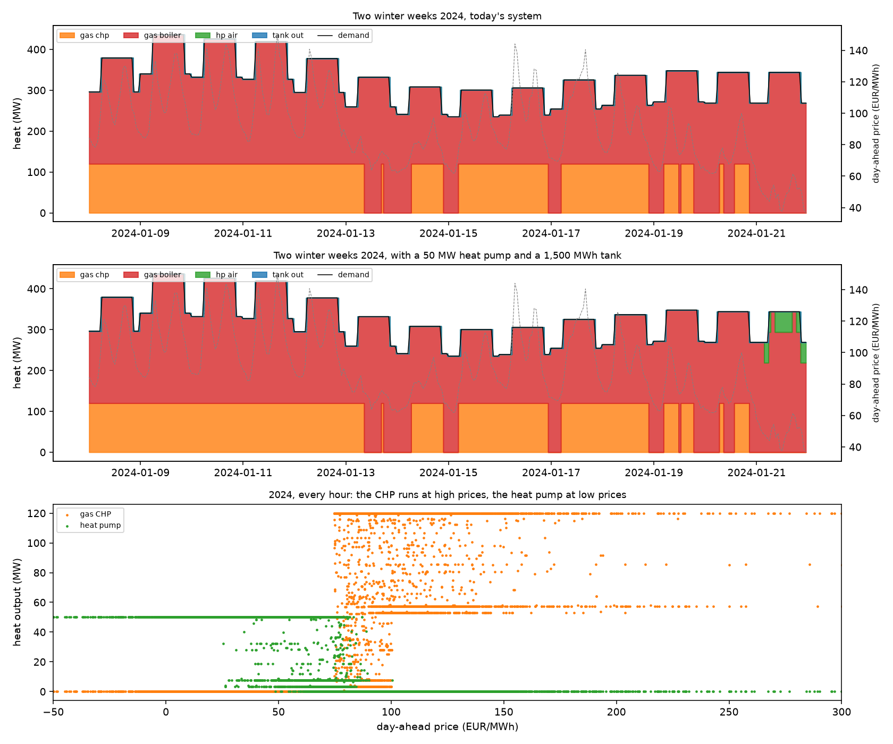
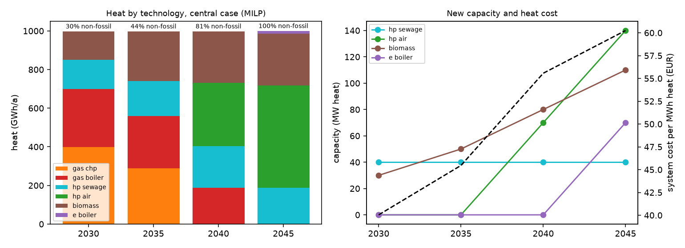
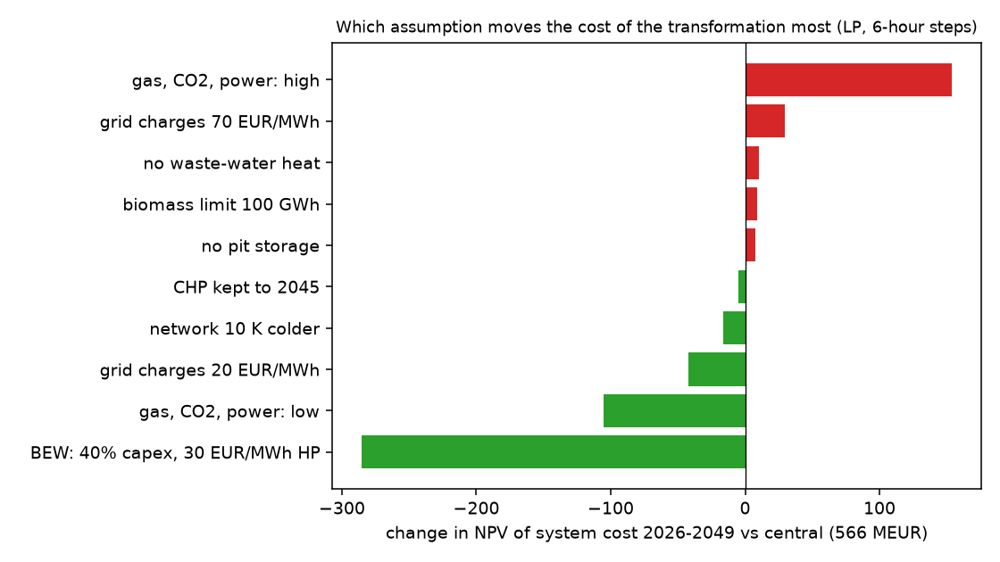

# District heating transformation of a German city: investment and dispatch optimisation in Python

[](https://github.com/michaelserikov/de-district-heating/actions/workflows/tests.yml)

An energy system model of an illustrative district heating network of about 1 TWh of heat per year, built in Python
(Pyomo, solved with the open-source HiGHS solver). It decides which heat generators and storages to build between
2030 and 2045 and how to run them hour by hour, so that the network meets the German heat planning law
(Wärmeplanungsgesetz, para 29: at least 30% heat from renewable energy or unavoidable waste heat from 2030, 80%
from 2040, climate neutral by 2045) at the lowest system cost. Weather is the real 2023-2025 record of
Dresden-Klotzsche (DWD), power prices are real German day-ahead prices (SMARD) and technology costs come from the
Danish Energy Agency technology catalogues.

The network is illustrative: its size, existing plants and local potentials are assumptions in one configuration
file, not the data of any utility. The model, the checks and the way results move with assumptions are the point.

## What the model does

| Element | Implementation |
|---|---|
| Heat demand | hourly, from DWD temperature with building inertia (SigLinDe-style smoothing), hot water and network losses |
| Generators | existing gas CHP (back-pressure) and gas boilers; new air-source and waste-water heat pumps (COP from a Lorenz cycle with sliding supply temperature), electric boiler, wood-chip boiler |
| Storage | tank and seasonal pit storage with standing losses, shared charge and discharge power |
| Markets | CHP electricity sold and heat-pump electricity bought at the hourly day-ahead price; grid charges, CO2 price, biomass price |
| Investment | milestone years 2030, 2035, 2040, 2045; capacity built stays; heat pumps, biomass and electric boilers in modules (MILP) or continuous (LP) |
| Policy | non-fossil share per milestone (WPG para 29), BEW investment and operating support as a scenario, KWKG bonus as an option |
| Quality | input checks before the solve, energy balance, capacity, storage, target and unserved-heat checks after it; priced slack instead of infeasibility |

All assumptions with sources are in [`config/base.yaml`](config/base.yaml); [`docs/user_guide.md`](docs/user_guide.md)
explains how to run variants from the command line.

## Main results

**1. Today's system (WP1, hourly, real prices and weather 2023-2025).** The gas CHP runs 3,100 to 4,300 full-load
hours a year, in hours with an average day-ahead price of 109 to 123 EUR/MWh against an annual mean of 79 to 95. A
50 MW air-source heat pump with a 1,500 MWh tank added to it runs in the cheap hours (average price 42 to 63
EUR/MWh) and covers 120 to 170 GWh of heat, but lowers the annual system cost by at most 0.7 million EUR (2023) and
not at all in 2024 and 2025 at 45 EUR/MWh of grid charges and levies on its electricity. Whether a large heat pump
pays depends more on what it pays on top of the power price than on the power price itself.



**2. Transformation pathway (WP2, MILP, central prices).**

| | 2030 | 2035 | 2040 | 2045 |
|---|---|---|---|---|
| non-fossil share of heat | 30% | 44% | 81% | 100% |
| waste-water heat pumps (MW) | 40 | 40 | 40 | 40 |
| air-source heat pumps (MW) | 0 | 0 | 70 | 140 |
| wood-chip boilers (MW) | 30 | 50 | 80 | 110 |
| electric boiler (MW) | 0 | 0 | 0 | 70 |
| pit storage / tank (MWh) | 3,000 / 0 | 3,000 / 0 | 3,000 / 0 | 3,000 / 5,400 |
| system cost per MWh of heat (EUR) | 40 | 45 | 56 | 60 |

The cheap non-fossil sources come first (waste-water heat at a high COP, then the limited local wood), the seasonal
pit storage is built at once because it moves heat from cheap to expensive hours (first for the CHP, later for the
heat pumps), and air-source heat pumps
arrive when the CHP leaves (assumed after 2038). The last step to 100% is the most expensive: the electric boiler
and the second tank cover cold spells that heat pumps alone would need far more capacity for. The existing gas
boilers stay as unused reserve. NPV of system cost 2026-2049: 569 million EUR (MILP, gap 0.6%); the LP relaxation
gives 566 million EUR with the same structure.



**3. Scenarios and sensitivities (WP3, LP).** Change of the NPV against the central case (566 million EUR):

| scenario | change (million EUR) | what changes in 2045 |
|---|---|---|
| gas, CO2 and power prices high / low | +154 / -105 | more heat pumps and biomass when high, more electric boiler when low |
| BEW: 40% investment grant and 30 EUR/MWh operating support for heat pumps | -285 | heat pumps 243 MW, no wood boilers, 12 GWh of tank |
| grid charges 70 / 20 EUR/MWh | +29 / -42 | at 20 EUR/MWh the electric boiler grows from 39 to 209 MW |
| supply and return 10 K colder | -16 | slightly smaller heat pumps for the same heat |
| no waste-water heat | +10 | 168 MW air-source instead |
| local wood limited to 100 GWh | +9 | 175 MW air-source |
| no pit storage | +8 | tank of 11.9 GWh instead |
| CHP kept to 2045 | -5 | same 2045 system |

Prices and subsidy design move the cost of the transformation far more than any technical choice; among the
technical levers, lowering the network temperature is worth more than the waste-water source or the pit. The grid
charge on electricity decides the mix between heat pumps and electric boilers. The BEW case uses an illustrative
operating support level; the real support is set per project by an economic-gap calculation.



**4. Data and model quality (WP4).**
- *Input checks* stop a run before the solve when the demand series has a gap or a target falls between milestone
  years.
- *Diagnosis instead of "infeasible":* a 2045 system restricted to 60 MW of heat pumps and no electric boiler does
  not fail; it reports 119 GWh of unserved heat in 1,623 hours between November and April, with a peak shortfall of
  252 MW at an average outdoor temperature of 1.6 degrees C.
- *Time resolution:* 6-hour steps (used for the pathway) cost 2% more than hourly steps for 2045 and size the
  electric boiler at 69 MW instead of 91 MW; heat pumps and storage differ by a few percent.
- *Solvers:* for the 2045 year at 3-hour steps, dual simplex and interior point both solve in about 30 seconds;
  the MILP with modules costs 0.5% more than the LP.
- *Scaling:* a check on storage flows found the same store charging and discharging at once. The cause was the
  objective in million EUR: small cost terms fell below the solver's tolerances and HiGHS reported "optimal" 0.2%
  above the true optimum. Expressed in thousand EUR, the solution is optimal and all checks pass; a regression
  test now covers it.

## Limitations

Illustrative network and potentials; one weather year (2024) for all milestones; future hourly power prices are the
2024 profile shifted to the scenario level, so more solar and wind in the future system are not reflected in price
shape; no unit commitment (minimum loads, start-up costs) for the CHP; network losses and temperatures do not depend
on the network operation; no hydrogen or biomethane options; daily demand profile with a simple day/night shape.

## Run it

```
python -m venv .venv && .venv/Scripts/activate
pip install -e ".[test]"
pytest -q
cd src && python -m fernwaerme.run pathway --name central
# work packages: python scripts/wp1_dispatch.py, scripts/wp23_scenarios.py, scripts/wp4_quality.py (PYTHONPATH=src)
```

## Data

| Data | Source | Licence |
|---|---|---|
| Hourly air temperature, station 01048 Dresden-Klotzsche | DWD Climate Data Center | CC BY 4.0 |
| Day-ahead prices DE-LU 2023-2025 | Bundesnetzagentur, SMARD | CC BY 4.0 |
| Monthly TTF gas and EU ETS prices | World Bank, ECB and EEX public series | public |
| Technology costs 2025-2045 | Danish Energy Agency technology catalogues via PyPSA technology-data v0.13.4 | CC BY 4.0 |

The German summary for decision makers is in [`docs/management_summary_de.md`](docs/management_summary_de.md).
